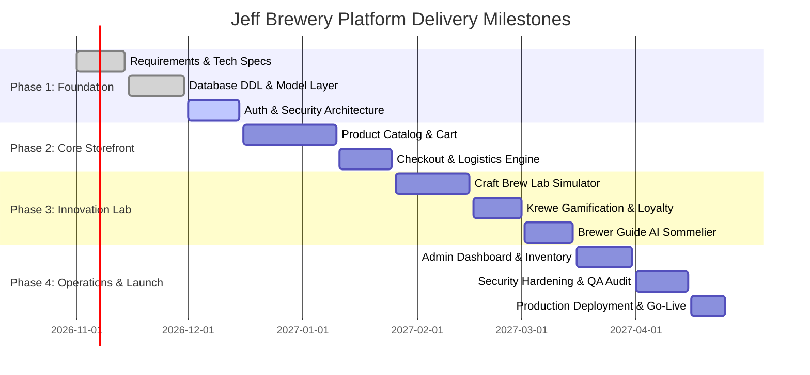

# Work Breakdown Structure (WBS)
## Project: Jeff Brewery Industries Platform
**Document Version:** 1.0.0  
**Status:** Approved Baseline  
**Target Region:** Couva & Port of Spain, Trinidad & Tobago  
**Domain:** Craft Brewery E-Commerce, Custom Brew Lab, Krewe Loyalty & AI Sommelier  

---

## 1. Executive Summary

The **Jeff Brewery Industries Platform** is an enterprise-grade craft brewing e-commerce, custom recipe formulation, and community engagement ecosystem. Built to celebrate Trinidad & Tobago’s vibrant brewing heritage, the platform integrates:
- **E-Commerce & Merchandising:** Caribbean craft beer catalog, island-wide delivery/pickup logistics, and taproom fulfillment.
- **Craft Brew Lab:** An interactive brewing simulator allowing customers to design custom batches, calculate ABV/IBU, and track live fermentation timelines.
- **Krewe Loyalty Program:** Carnival-inspired multi-tier gamification (Road Crew, Mas Band, Section Leader, Inner Circle) with point accrual, badge achievements, and VIP reward redemptions.
- **Brewer Guide AI ("LimeBot"):** An intelligent conversational sommelier and recommendation engine tailored to local palates and Caribbean food pairings.
- **Enterprise Operations & Admin:** Real-time inventory tracking, brewing queue scheduler, sales analytics, and fulfillment management.

This Work Breakdown Structure (WBS) defines the complete hierarchical decomposition of deliverables required to build, test, secure, and deploy the platform.

---

## 2. High-Level WBS Architecture (Mermaid Diagram)

```mermaid
graph TD
    WBS["Jeff Brewery Platform (0.0)"]

    WBS --> P1["1.0 Architecture & Planning"]
    WBS --> P2["2.0 Data Engine & Persistence"]
    WBS --> P3["3.0 Identity & Access (IAM)"]
    WBS --> P4["4.0 Storefront & E-Commerce"]
    WBS --> P5["5.0 Craft Brew Lab Engine"]
    WBS --> P6["6.0 Krewe Loyalty & Gamification"]
    WBS --> P7["7.0 Brewer Guide AI Sommelier"]
    WBS --> P8["8.0 Admin & Operations Center"]
    WBS --> P9["9.0 QA, Security & Compliance"]
    WBS --> P10["10.0 DevOps, Cloud & Release"]

    P1 --> P1_1["1.1 Requirements & System Architecture"]
    P1 --> P1_2["1.2 UI/UX Design System & Theme Engine"]
    
    P2 --> P2_1["2.1 Relational DDL & ERD Design"]
    P2 --> P2_2["2.2 Database Abstraction & ORM/PDO"]
    
    P3 --> P3_1["3.1 Authentication & Session Security"]
    P3 --> P3_2["3.2 Role-Based Access Control (RBAC)"]
    
    P4 --> P4_1["4.1 Beer & Merch Catalog Engine"]
    P4 --> P4_2["4.2 Cart, Checkout & TT Logistics"]
    
    P5 --> P5_1["5.1 Custom Recipe Builder & ABV/IBU Math"]
    P5 --> P5_2["5.2 Batch Pipeline & Fermentation Tracker"]
    
    P6 --> P6_1["6.1 Points Engine & Carnival Tiers"]
    P6 --> P6_2["6.2 Badges & Reward Redemptions"]
    
    P7 --> P7_1["7.1 NLP Intent & Pairing Engine"]
    P7 --> P7_2["7.2 Session State & Analytics Tracker"]
    
    P8 --> P8_1["8.1 KPI Dashboard & Live Feeds"]
    P8 --> P8_2["8.2 Inventory & Batch Brew Scheduler"]
    
    P9 --> P9_1["9.1 Security Audit & OWASP Top 10"]
    P9 --> P9_2["9.2 End-to-End & Performance Tests"]
    
    P10 --> P10_1["10.1 Docker & Environment Config"]
    P10 --> P10_2["10.2 Firebase / Cloud Run CI/CD"]
```

---

## 3. Hierarchical Work Breakdown Structure

### 1.0 Architecture & Project Governance
- **1.1 Requirements & System Architecture**
  - 1.1.1 Stakeholder discovery (E-commerce, Master Brewer, Taproom manager, Trinidad logistics).
  - 1.1.2 Functional specification and architectural blueprint (MVC architecture, routing specifications).
  - 1.1.3 Regulatory compliance (Alcohol e-commerce, age verification protocols, local tax compliance).
- **1.2 UI/UX Design System & Caribbean Aesthetic**
  - 1.2.1 Design tokens: Color palette (Gold, Emerald, Caribbean Cyan, Midnight Charcoal), typography (`Plus Jakarta Sans`, `Outfit`).
  - 1.2.2 Component library: Glassmorphism headers, interactive beer cards, badges, and modal dialogs.
  - 1.2.3 Responsive mobile layouts (Optimized for Carnival road and mobile ordering).

---

### 2.0 Database Architecture & Persistence Layer
- **2.1 Relational Schema Design & DDL**
  - 2.1.1 Entity Relationship Diagram (ERD) definition across 6 domains (`erd-schema.json`, `public/erd.html`).
  - 2.1.2 Production DDL creation (`schema.sql` with MySQL 8.0/MariaDB compatibility).
  - 2.1.3 Database constraints, primary keys, cascading foreign keys, and performant indexes (`idx_users_email`, `idx_beers_style`, `idx_orders_status`).
  - 2.1.4 Initial seed dataset creation (Core brews, Caribbean ingredients, Krewe badge fixtures, mock reviews).
- **2.2 Data Abstraction & Storage Connectors**
  - 2.2.1 Unified PDO connection management (`app/models/Database.php`) with graceful fallback to session state.
  - 2.2.2 Query optimization for high-concurrency peak orders (e.g., Carnival seasonal release spikes).
  - 2.2.3 Automated database backup and point-in-time recovery strategy.

---

### 3.0 Identity, Access & User Profiles (IAM)
- **3.1 Authentication & Session Management**
  - 3.1.1 Secure customer registration and login with Argon2id / Bcrypt password hashing.
  - 3.1.2 Session hijacking protection, secure cookie flags (`HttpOnly`, `SameSite=Lax`, `Secure`).
  - 3.1.3 Password recovery and email verification workflows.
- **3.2 Role-Based Access Control (RBAC)**
  - 3.2.1 Role definition: `Customer`, `Brewer`, and `Admin`.
  - 3.2.2 Middleware route guards verifying controller privileges (`AdminController`, `CraftController`).
- **3.3 Customer Profile & Portal**
  - 3.3.1 Profile dashboard: Contact info, favorite styles, bio, and member tenure.
  - 3.3.2 Real-time order history tracking with TT-Post and taproom pickup codes.
  - 3.3.3 Interactive Wishlist management and brew review history.

---

### 4.0 Storefront & E-Commerce Subsystem
- **4.1 Product Catalog & Discovery**
  - 4.1.1 Core beer showcase (ABV, IBU, tasting notes, island origin stories, Couva estate history).
  - 4.1.2 Dynamic filtering (by style: IPA, Stout, Saison, Lager, Fruit Ale; by availability: Core, Seasonal, Limited).
  - 4.1.3 Merch & Apparel catalog (Carnival coolers, tees, branded glassware, gift cards).
  - 4.1.4 Customer reviews and rating submission system.
- **4.2 Shopping Cart & Session Engine**
  - 4.2.1 Server-side session cart with quantity controls and real-time total recalculation.
  - 4.2.2 Inventory stock pre-check and reserve locking.
- **4.3 Checkout & Multi-Channel Fulfillment**
  - 4.3.1 Trinidad & Tobago delivery zones (Port of Spain, Couva, San Fernando, East-West Corridor, Tobago courier).
  - 4.3.2 Brewery taproom pickup selector with unique pickup claim codes (e.g., `PICKUP-8719-VIP`).
  - 4.3.3 Order confirmation, digital invoice generation, and status progression engine:
    - *Order Placed* $\rightarrow$ *Brewing & Bottling* $\rightarrow$ *Out for Delivery / Ready for Taproom Collection* $\rightarrow$ *Delivered*.

---

### 5.0 Craft Brew Lab Engine ("Craft Your Own")
- **5.1 Custom Recipe Builder & Flavor Engineering**
  - 5.1.1 Base malt and fermentable selector (Pilsner Malt, Pale Ale, Roasted Barley, Wheat).
  - 5.1.2 Caribbean adjunct & flavor infusion matrix (Tobago Organic Cacao, Moruga Scorpion, Sorrel, Coconut, Lime).
  - 5.1.3 Hops & bittering profile selector (Citra, Mosaic, Cascade, Saaz).
  - 5.1.4 Real-time mathematical simulation:
    - ABV calculation engine based on grain bill and yeast attenuation.
    - IBU calculation based on alpha-acid utilization and boil time.
- **5.2 Custom Batch Production & Timeline Pipeline**
  - 5.2.1 Unique batch identifier generator (e.g., `BATCH-MNG-9842`).
  - 5.2.2 Custom label naming, personalized packaging, and batch notes.
  - 5.2.3 5-Stage fermentation timeline tracking:
    - *Mashing & Boiling (Day 1)* $\rightarrow$ *Primary Fermentation (Days 2-7)* $\rightarrow$ *Dry Hopping & Infusion (Days 8-12)* $\rightarrow$ *Conditioning & Carbonation (Days 13-18)* $\rightarrow$ *Bottling & Quality Testing (Day 19-21)*.
  - 5.2.4 "Add Custom Brew to Cart" e-commerce checkout integration.

---

### 6.0 Krewe Loyalty & Gamification System
- **6.1 Point Economy & Tier Progression**
  - 6.1.1 Multi-tier classification system:
    - **Road Crew** (0 – 499 pts)
    - **Mas Band** (500 – 999 pts)
    - **Section Leader** (1,000 – 1,999 pts)
    - **Inner Circle** (2,000+ pts)
  - 6.1.2 Event-driven point awards: Account creation (+100 pts), order purchases (10 pts per $1 TTD), custom recipe saved (+100 pts), review submitted (+50 pts), LimeBot interaction (+5 pts).
- **6.2 Badge Engine & Achievements**
  - 6.2.1 Badge qualification rules (`first_sip`, `island_explorer`, `krewe_vip`, `master_blender`, `review_guru`).
  - 6.2.2 Real-time badge unlocking notification modal with visual celebration.
- **6.3 Krewe Rewards Store & Redemption**
  - 6.3.1 Redeemable perks: Taproom flight discounts, VIP Brewery tour passes, free merchandise, seasonal release pre-orders.
  - 6.3.2 Dynamic redemption validation preventing negative point balances.

---

### 7.0 Brewer Guide AI Sommelier ("LimeBot")
- **7.1 Conversational Intelligence & Rule-Based NLP**
  - 7.1.1 Natural Language intent parser for beer recommendation queries (flavors, sweetness, bitterness, strength).
  - 7.1.2 Trinbagonian culinary pairing advisor (e.g., matching IPA with Spicy Geera Pork or Doubles; Stout with Tobago Cocoa ribs).
  - 7.1.3 Order status query handler and taproom liming FAQ responder.
- **7.2 Recommendation Engine & Scoring**
  - 7.2.1 Dynamic similarity matching algorithm based on user taste preferences and ABV/IBU profiles.
  - 7.2.2 Quick-reply interactive suggestion chips for rapid mobile queries.
  - 7.2.3 Gamification link: Automatic Krewe point bonus for engaging with the guide.
- **7.3 Sommelier Analytics & Tracking**
  - 7.3.1 User query logging and conversion tracking (Recommendation $\rightarrow$ Add to Cart $\rightarrow$ Purchase).

---

### 8.0 Operations & Admin Command Center
- **8.1 Real-Time Executive KPIs & Monitoring**
  - 8.1.1 Revenue metrics, average order value (AOV), active orders, and conversion rate by period (7d, 30d, 90d, Annual).
  - 8.1.2 Live customer activity stream (Logins, custom recipes, order state updates, badge unlocks).
  - 8.1.3 AI recommendation conversion funnel analysis.
- **8.2 Inventory & Stock Replenishment**
  - 8.2.1 Low-stock warning thresholds with color-coded stock health indicators.
  - 8.2.2 Beer stock adjustment tools and restock batch logger.
- **8.3 Order & Fulfillment Management**
  - 8.3.1 Master order grid with one-click status transitions.
  - 8.3.2 Dispatch slips, courier tracking assignment (TT-Post), and taproom pickup verification.
- **8.4 Custom Batch Brewing Queue**
  - 8.4.1 Master brewer queue for customer-submitted recipes.
  - 8.4.2 Stage progression controllers to update customer tracking portals.

---

### 9.0 Quality Assurance, Security & Performance
- **9.1 Security & Defensive Hardening**
  - 9.1.1 Input sanitization and parameterized SQL / PDO statements (SQL Injection prevention).
  - 9.1.2 Cross-Site Scripting (XSS) mitigation via HTML output encoding (`htmlspecialchars`).
  - 9.1.3 Cross-Site Request Forgery (CSRF) token generation and validation on mutations.
  - 9.1.4 Rate limiting on authentication and AI chatbot endpoints.
- **9.2 Testing & Quality Assurance**
  - 9.2.1 Unit testing: Cart math, ABV/IBU formulas, point deduction validations.
  - 9.2.2 Integration testing: Order checkout through to inventory decrement.
  - 9.2.3 Cross-browser & device responsiveness verification (Desktop, iOS Safari, Android Chrome).
  - 9.2.4 Database query benchmark under simulated load.

---

### 10.0 DevOps, Cloud Infrastructure & Release
- **10.1 Containerization & Local Runtime**
  - 10.1.1 Production `Dockerfile` optimization (PHP 8.2+ Apache, `mod_rewrite`, extensions).
  - 10.1.2 `.htaccess` URL rewrite routing configuration.
  - 10.1.3 Environment configuration management (`.env` separation for secrets and database credentials).
- **10.2 CI/CD & Cloud Deployment**
  - 10.2.1 Firebase hosting configuration (`firebase.json`, `.firebaserc`).
  - 10.2.2 Cloud Run / GCP container deployment pipelines.
  - 10.2.3 SSL/TLS certificate setup and custom domain configuration (`jeffbrewery.com`).
  - 10.2.4 Post-launch smoke tests and disaster recovery runbook.

---

## 4. Comprehensive WBS Dictionary

| WBS Code | Work Package / Deliverable Name | Description & Scope | Primary Owner | Est. Effort (SP / Hrs) | Key Dependencies | Acceptance Criteria |
| :--- | :--- | :--- | :--- | :--- | :--- | :--- |
| **1.1** | System Specification & Regulatory | Define functional specifications, data privacy, and legal age-gating rules for Trinidad & Tobago. | Product Owner / Legal | 5 SP (40h) | None | Signed-off System Architecture Document & legal age-gate flow. |
| **1.2** | UI/UX Design System | Build modular CSS tokens, glassmorphism cards, responsive navigation, and iconography. | UI/UX Lead | 8 SP (60h) | 1.1 | Complete style guide, reusable components, and WCAG AA contrast compliance. |
| **2.1** | Relational DDL & ERD Design | Write full relational database schema across 6 domains with ANSI SQL integrity constraints. | Database Architect | 8 SP (60h) | 1.1 | Validated `schema.sql`, interactive `public/erd.html`, foreign keys functional. |
| **2.2** | Database Layer & Fallback Engine | Implement `Database.php` PDO connection with mock-data fallback for development. | Backend Lead | 5 SP (40h) | 2.1 | Seamless data access with zero fatal crashes on disconnected DB. |
| **3.1** | Auth & Session Security | Build customer registration, password encryption, and tamper-proof session handling. | Backend Security Eng | 5 SP (40h) | 2.2 | Safe session cookies, Argon2id/Bcrypt hashing, protected login/logout. |
| **3.2** | Role-Based Access Control | Enforce access control for `Customer`, `Brewer`, and `Admin` users. | Full Stack Eng | 3 SP (24h) | 3.1 | Unauthorized users blocked from `/admin` and brewer actions with HTTP 403. |
| **3.3** | User Profile & Order History | Account center displaying tier status, badges, saved recipes, and past orders. | Frontend Eng | 5 SP (40h) | 3.1, 4.3 | Accurate rendering of user data, live order status, and wishlist. |
| **4.1** | Beer & Merch Catalog | Dynamic product listing with multi-attribute filtering (style, ABV, price, stock). | Full Stack Eng | 8 SP (60h) | 1.2, 2.2 | Fast search, filter by style, detailed modal views, out-of-stock badges. |
| **4.2** | Cart & Session Storage | Shopping cart calculations, quantity modifications, and item persistence. | Frontend Eng | 5 SP (35h) | 4.1 | Accurate cart subtotal, shipping addition, discount subtraction. |
| **4.3** | Checkout & Order Dispatching | Multi-step checkout with delivery zones or brewery taproom collection options. | Backend Lead | 8 SP (65h) | 4.2 | Successful order generation with order ID, inventory reduction, and invoice email. |
| **5.1** | Craft Lab Recipe Engine | Interactive visual formula builder calculating ABV and IBU dynamically. | Lead Brew Technologist | 13 SP (90h) | 1.2, 2.2 | Formula matches brewing science formulas within ±0.2% ABV and ±2 IBU. |
| **5.2** | Fermentation Batch Pipeline | Batch code generation and 5-stage timeline progression tracker. | Backend Eng | 8 SP (55h) | 5.1 | Distinct batch IDs, stage updates reflected in user profile in real-time. |
| **6.1** | Krewe Points & Tier Engine | Point transaction logging, tier elevation logic, and lifetime totals. | Backend Eng | 5 SP (40h) | 3.1, 4.3 | Automatic tier promotion when point thresholds (500, 1000, 2000) are met. |
| **6.2** | Gamification Badges & Rewards | Visual badge achievements and rewards store redemption system. | Frontend / Gamification | 5 SP (40h) | 6.1 | Badges unlock on condition triggers; points deducted on reward claim. |
| **7.1** | Brewer Guide AI Sommelier | Natural language recommendation bot with Trinbagonian food & beer pairings. | AI / NLP Eng | 8 SP (60h) | 4.1 | Accurately returns matching beers with match percentage and culinary suggestions. |
| **7.2** | Sommelier Conversion Tracker | Log queries, capture click-throughs to cart, and award interaction points. | Data / Backend Eng | 3 SP (20h) | 7.1, 6.1 | Session analytics logged; +5 Krewe points credited per valid chat query. |
| **8.1** | Admin Operations Dashboard | Executive KPI dashboard with revenue, orders, active customers, and live feed. | Full Stack Eng | 8 SP (60h) | 4.3, 3.2 | Real-time KPI cards, time-period filters (7d, 30d, 90d, Year) fully functional. |
| **8.2** | Inventory & Stock Controls | Visual stock level monitoring, replenishment alerts, and restock actions. | Backend Eng | 5 SP (35h) | 4.1, 8.1 | Stock warning indicators triggered at $\le 15$ units; restock updates DB immediately. |
| **8.3** | Order Fulfillment Console | Status management portal for pickup and courier delivery fulfillment. | Full Stack Eng | 5 SP (40h) | 4.3, 8.1 | Seamless transition through all 5 order fulfillment stages. |
| **9.1** | Security Audit & Pen-Testing | Vulnerability testing against OWASP Top 10 vulnerabilities and CSRF auditing. | Security Specialist | 8 SP (50h) | All 3.x-8.x | Zero critical or high-severity vulnerabilities; verified CSRF & XSS protections. |
| **9.2** | End-to-End & Load Testing | Complete regression testing across browsers and load testing checkout under spike load. | QA Engineer | 5 SP (40h) | All 4.x-8.x | 100% pass on critical checkout flows; sub-800ms response time under 200 req/sec. |
| **10.1** | Docker Containerization | Multi-stage Docker build with PHP 8.2, Apache, and rewrite modules. | DevOps Eng | 3 SP (25h) | 2.2 | Production Docker image building cleanly and running locally via container. |
| **10.2** | Cloud Deployment & CI/CD | Deployment configuration for Firebase / Cloud Run and SSL automation. | DevOps Lead | 5 SP (35h) | 10.1 | Automated deployment pipeline, zero-downtime cutover, green healthcheck. |

---

## 5. Responsibility Assignment Matrix (RACI)

*Legend: **R** = Responsible (Does the work), **A** = Accountable (Approves), **C** = Consulted (Provides input), **I** = Informed (Kept updated)*

| WBS Domain | Product Owner | Tech Lead / Architect | Frontend Eng | Backend Eng | QA / Security | DevOps | Master Brewer |
| :--- | :---: | :---: | :---: | :---: | :---: | :---: | :---: |
| **1.0 Architecture & Planning** | **A** | **R** | C | C | C | C | C |
| **2.0 Database & Persistence** | I | **A** | I | **R** | C | C | I |
| **3.0 Identity & Access (IAM)** | I | **A** | C | **R** | C | I | I |
| **4.0 Storefront & E-Commerce** | C | **A** | **R** | **R** | C | I | C |
| **5.0 Craft Brew Lab Engine** | C | **A** | **R** | **R** | C | I | **R** |
| **6.0 Krewe Loyalty & Gamification** | **A** | C | **R** | **R** | I | I | I |
| **7.0 Brewer Guide AI Sommelier** | C | **A** | C | **R** | C | I | C |
| **8.0 Admin & Operations Center** | C | **A** | **R** | **R** | I | I | C |
| **9.0 QA & Security Hardening** | I | A | C | C | **R** | C | I |
| **10.0 Cloud Deployment & DevOps** | I | A | I | C | C | **R** | I |

---

## 6. Phased Implementation Roadmap & Milestones

### Major Milestones:
1. **Milestone 1 (M1) - Data & Security Baseline:** Database schema, migrations, user authentication, and RBAC verified.
2. **Milestone 2 (M2) - Minimum Viable Storefront:** Product browsing, shopping cart, and mock order checkout functioning.
3. **Milestone 3 (M3) - Interactive Craft Lab & Gamification:** Custom recipe ABV/IBU simulator and Krewe points/badges online.
4. **Milestone 4 (M4) - Sommelier & Admin Ready:** LimeBot AI recommendations live; Admin order management and inventory console operable.
5. **Milestone 5 (M5) - Commercial Launch:** Full deployment on Docker/Cloud Run with SSL, payment/delivery logistics in Trinidad & Tobago.

---

## 7. Project Risk Management Matrix

| Risk ID | Risk Description | Likelihood | Impact | Mitigation Strategy |
| :--- | :--- | :---: | :---: | :--- |
| **RSK-01** | High latency on AI chatbot queries during peak site traffic. | Medium | Medium | Implement local rule-based intent caching, pre-compiled recommendation clusters, and asynchronous analytics logging. |
| **RSK-02** | Inventory overselling during seasonal Carnival batch drops. | High | High | Implement transactional database row locking on checkout initiation with a 15-minute reservation hold. |
| **RSK-03** | Custom Brew recipe calculation discrepancies with real brewing output. | Medium | Medium | Calibrate algorithmic formulas directly with Head Brewer testing data and display clear tolerance margins ($\pm 0.3\%$ ABV). |
| **RSK-04** | Security vulnerabilities in customer session or delivery data. | Low | Critical | Strict PDO prepared queries, automated CSRF validation, HTTP-only secure cookie enforcement, and input sanitization. |
| **RSK-05** | Courier delivery delays across Trinidad & Tobago islands. | Medium | Low | Real-time tracking link with TT-Post API and clear taproom pickup alternative with VIP barcode/pickup code. |
